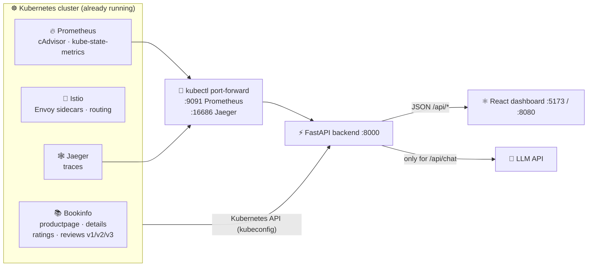
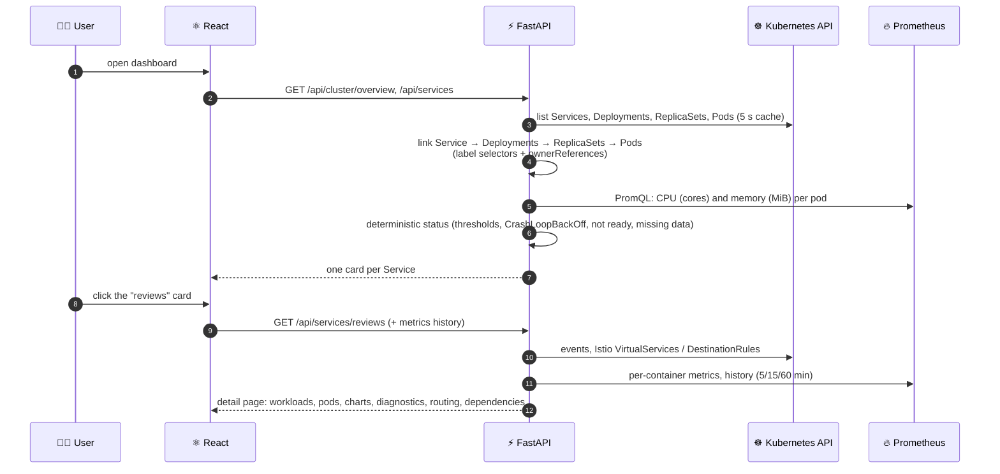
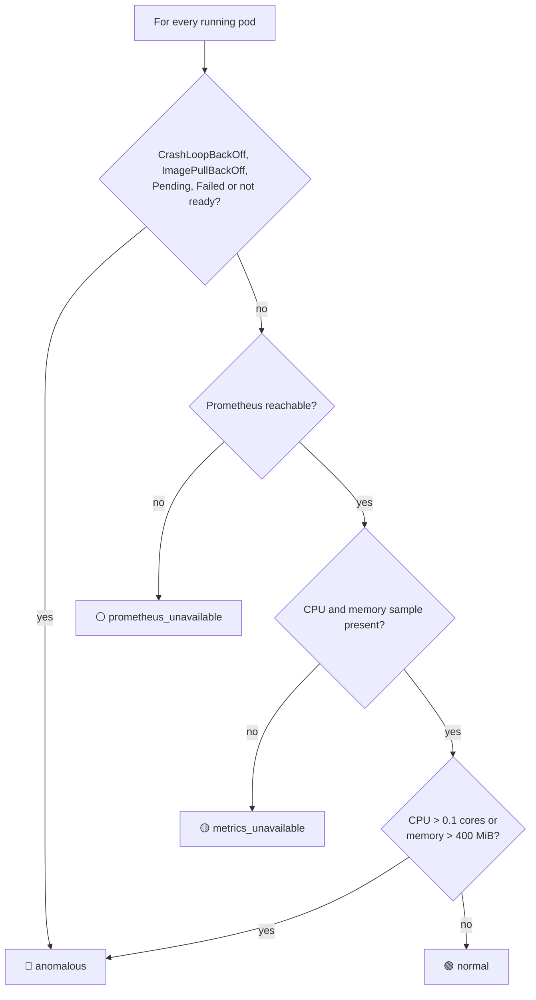
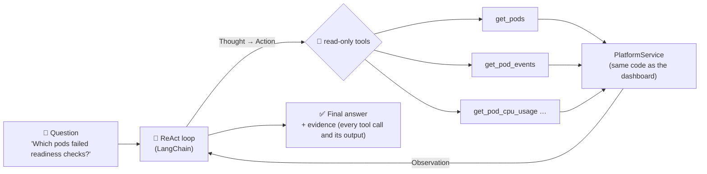
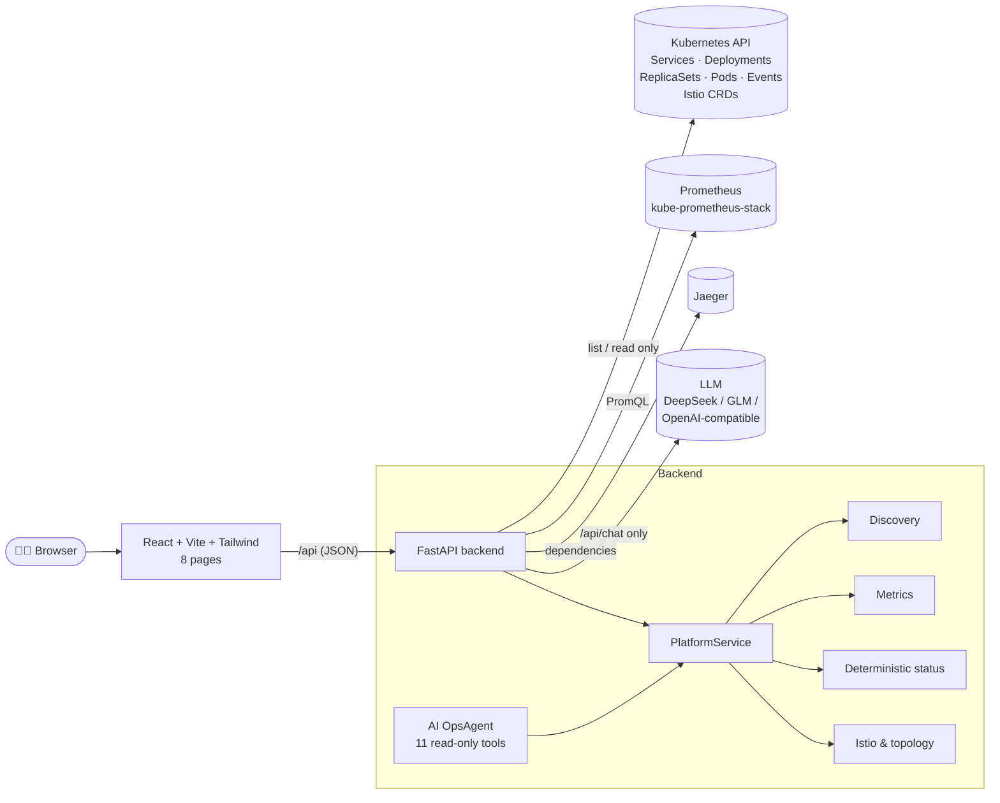

<div align="center">

# 📚 Bookinfo Ops Platform

### Kubernetes Observability & AI Operations for the Istio Bookinfo Microservices

Live microservice inventory, per-service drill-down, Prometheus metrics, deterministic anomaly detection<br/>
and a read-only AI OpsAgent that answers questions about your cluster, with evidence.

<br/>


[Features](#-features) •
[How it works](#-how-it-works) •
[Architecture](#-architecture) •
[Quick start](#-quick-start) •
[API](#-api) •
[AI OpsAgent](#-ai-opsagent) •
[Testing](#-testing) •
[Docs](#-documentation)

</div>

---

## ✨ Features

| | Feature | Details |
|---|---|---|
| 🧭 | **Microservice inventory** | Every Bookinfo service (productpage, details, ratings, reviews) as a live card with health, replicas, pods, CPU, memory, restarts and versions. |
| 🔎 | **Per-service detail pages** | `/services/<name>`: Service object, Deployments → ReplicaSets → Pods → containers, images, IPs, nodes, probes, requests/limits, events. |
| 🧬 | **Versions done right** | `reviews` is **one** Service with **three** versions (v1/v2/v3). It is linked through label selectors and owner references, with no hard-coded names. |
| 📈 | **Prometheus metrics** | CPU (cores) and memory working set (MiB) per pod and per container, with 5 / 15 / 60 min history and the PromQL shown in the UI. |
| 🚦 | **Deterministic anomaly detection** | `normal` · `anomalous` · `prometheus_unavailable` · `metrics_unavailable`, naming the offending pod and metric. No LLM is involved. |
| 🕸️ | **Evidence-based dependencies** | Service calls come from Istio telemetry or Jaeger traces and are never guessed from names. Missing data is explained. |
| 🔀 | **Istio routing** | VirtualService weights (e.g. reviews 20 / 40 / 40) and DestinationRule subsets for each service. |
| 🤖 | **AI OpsAgent** | A LangChain ReAct agent with 11 **read-only** tools. It answers questions like *"Which pod uses the most CPU?"* and shows every tool call as evidence. |
| 🛡️ | **Safe by design** | No write, delete, scale or exec code anywhere. Secrets live only in `.env`, and the frontend never sees them. |
| ❔ | **Honest UI** | Unknown values are shown as "—", never as 0. Every view has loading skeletons, error states with hints, and empty states. |
| 🐳 | **Docker Compose** | Frontend (nginx) and backend containers, with an offline build that works behind restrictive networks. |

---

## 🔄 How it works

The platform does **not** deploy or change anything. It sits next to an existing cluster and only **reads**.



### 1 · What happens when you open the dashboard



### 2 · How a service is discovered (nothing hard-coded)

| Step | Rule | Example (`reviews`) |
|---|---|---|
| Service → Pods | `service.spec.selector` ⊆ pod labels | `app=reviews` → 3 pods |
| Service → Deployments | selector ⊆ Deployment template labels | reviews-v1, reviews-v2, reviews-v3 |
| Pod → ReplicaSet → Deployment | `metadata.ownerReferences` | `reviews-v2-6dfdd6c5b9-qdbsd` → `reviews-v2-6dfdd6c5b9` → `reviews-v2` |
| Version | pod label `version` | v1 · v2 · v3 |
| Sidecar | containers + native sidecars (`initContainers` with `restartPolicy: Always`) | `istio-proxy` |

### 3 · How the health status is decided (no AI)



A missing value is shown as "—" and is **never** counted as 0 or as healthy.

### 4 · How the AI OpsAgent answers



The agent has **no tool that can change the cluster**. A loop guard stops repeated identical calls, and LLM errors are
returned as structured HTTP errors with the API key removed.

### 5 · Daily workflow: what to run, in which window

| # | Window | Command | Keep open? |
|---|---|---|---|
| 1 | any | `kubectl config use-context docker-desktop` | – |
| 2 | any | `.\scripts\start-port-forwards.ps1` → opens 2 minimized windows | ✅ yes |
| 3 | backend | `cd backend; .\.venv\Scripts\Activate.ps1; uvicorn app.main:app --reload --port 8000` | ✅ yes |
| 4 | frontend | `cd frontend; npm run dev` | ✅ yes |
| 5 | browser | http://localhost:5173 · API docs http://127.0.0.1:8000/docs | – |

Shortcut after the first set-up: `.\scripts\start-port-forwards.ps1` and then `.\scripts\start-dev.ps1` (opens steps 3 and 4).

---

## 🏗️ Architecture



The REST API and the AI agent share **one** `PlatformService`, so the dashboard and the agent always see the same facts.
Details: [docs/architecture.md](docs/architecture.md).

<details>
<summary><b>📁 Project structure</b></summary>

```
bookinfo-ops-platform/
├── backend/                     FastAPI (Python 3.11+)
│   ├── app/
│   │   ├── main.py              app, CORS, logging, structured errors
│   │   ├── config.py            settings from environment variables
│   │   ├── schemas.py           Pydantic request / response models
│   │   ├── routers/api.py       all /api endpoints (OpenAPI at /docs)
│   │   ├── clients/             read-only Kubernetes, Prometheus, Jaeger clients
│   │   ├── services/            discovery · metrics · status · topology · platform
│   │   └── agent/               AI OpsAgent (ReAct runner, tools, parser, loop guard)
│   ├── tests/                   unit · API · live integration
│   └── Dockerfile
├── frontend/                    React 18 + Vite 5 + Tailwind 3 + Recharts
│   ├── src/pages/               Overview · Microservices · Service detail · Pods ·
│   │                            Monitoring · AI agent · Events · Settings
│   ├── src/components/          Layout, ServiceCard, charts, UI states
│   ├── tests/                   vitest + Testing Library
│   └── Dockerfile
├── scripts/                     PowerShell helpers (port-forwards, dev, tests, Docker)
├── docs/                        architecture · API · deployment · testing · requirements
├── compose.yaml
└── .env.example
```
</details>

---

## 🚀 Quick start

### Prerequisites

| Tool | Version | Check |
|---|---|---|
| ☸️ Kubernetes with Istio Bookinfo | namespace `bookinfo` | `kubectl get pods -n bookinfo` |
| 🔥 Prometheus (kube-prometheus-stack) | namespace `monitoring` | `kubectl get svc -n monitoring` |
| 🐍 Python | 3.11+ | `python --version` |
| 🟢 Node.js | 20+ | `node --version` |
| 🐳 Docker Desktop | optional, for Compose | `docker --version` |

### 1 · Configure

```powershell
git clone https://github.com/<your-user>/bookinfo-ops-platform.git
cd bookinfo-ops-platform
Copy-Item .env.example .env        # then set K8S_CONTEXT and LLM_API_KEY
```

### 2 · Port-forward Prometheus and Jaeger

```powershell
.\scripts\start-port-forwards.ps1  # Prometheus → 127.0.0.1:9091, Jaeger → 127.0.0.1:16686
```

### 3 · Backend

```powershell
cd backend
python -m venv .venv
.\.venv\Scripts\Activate.ps1
pip install -r requirements-dev.txt
uvicorn app.main:app --reload --port 8000     # API docs: http://127.0.0.1:8000/docs
```

### 4 · Frontend

```powershell
cd frontend
npm install
npm run dev                                   # http://localhost:5173
```

### 🐳 Or with Docker Compose

```powershell
.\scripts\start-port-forwards.ps1 -ListenAll
.\scripts\make-docker-kubeconfig.ps1          # read-only kubeconfig for the backend container only
.\scripts\prepare-docker-build.ps1            # offline build: React build + Linux wheels on the host
docker compose up --build                     # dashboard: http://localhost:8080
```

<details>
<summary><b>⚙️ Configuration (.env)</b></summary>

| Variable | Default | Purpose |
|---|---|---|
| `K8S_CONTEXT` | `docker-desktop` | kubeconfig context |
| `K8S_NAMESPACE` | `bookinfo` | monitored namespace |
| `PROMETHEUS_URL` | `http://127.0.0.1:9091` | Prometheus base URL |
| `PROMETHEUS_USE_SYSTEM_PROXY` | `false` | ignore the system proxy for local endpoints |
| `JAEGER_URL` | `http://127.0.0.1:16686/jaeger` | Jaeger query API (optional) |
| `CPU_THRESHOLD_CORES` | `0.1` | anomaly threshold per pod |
| `MEMORY_THRESHOLD_MIB` | `400` | anomaly threshold per pod |
| `LLM_PROVIDER` / `LLM_MODEL` | `deepseek` / `deepseek-chat` | any OpenAI-compatible provider |
| `LLM_BASE_URL` | `https://api.deepseek.com` | e.g. Zhipu GLM: `https://open.bigmodel.cn/api/paas/v4/` |
| `LLM_API_KEY` | – | **secret**, only in `.env` |

</details>

---

## 🔌 API

Interactive OpenAPI docs are served at **`/docs`**. All responses use CPU in cores, memory in MiB and UTC ISO-8601
timestamps, and unknown values are `null`.

| Method | Endpoint | Description |
|---|---|---|
| `GET` | `/api/health` | Kubernetes and Prometheus connectivity |
| `GET` | `/api/cluster/overview` | Overview totals and warnings |
| `GET` | `/api/services` | Service inventory (cards) |
| `GET` | `/api/services/{name}` | Full detail-page data |
| `GET` | `/api/services/{name}/workloads` · `/pods` · `/events` | Workloads, pods, events |
| `GET` | `/api/services/{name}/metrics/cpu` · `/memory` | History (`?minutes=5\|15\|60&by=pod\|container`) |
| `GET` | `/api/metrics/cpu` · `/memory` · `/restarts` | Namespace-wide metrics |
| `GET` | `/api/pods` · `/api/events` · `/api/dependencies` | Pods, events, call graph |
| `GET` | `/api/status` | Deterministic anomaly status |
| `POST` | `/api/chat` | Ask the AI OpsAgent |

Errors are structured: `{"error": {"code": "PROMETHEUS_UNAVAILABLE", "message": "...", "details": {...}}}`.
Full reference: [docs/api-documentation.md](docs/api-documentation.md).

---

## 🤖 AI OpsAgent

A LangChain **ReAct** agent. It is limited to **read-only tools** that call the same service layer as the dashboard.

```text
You      ▸ Which Pods have failed readiness checks?
OpsAgent ▸ Two pods had failed readiness checks in the last hour (all are Ready now):
           reviews-v1 (12×) and ratings-v1 (7×) – istio-proxy /healthz/ready timed out.
Evidence ▸ get_pods({...}) · get_pod_events({...})
```

| Tools | |
|---|---|
| 🧩 `get_services` · `get_deployments` · `get_pods` | inventory and current state |
| 📊 `get_pod_cpu_usage` · `get_pod_memory_usage` · `get_metric_trend` | Prometheus metrics |
| 🔁 `get_container_restarts` · `get_pod_events` | restarts, probe failures, events |
| 🩺 `get_service_health` · `get_anomaly_status` · `get_prometheus_status` | health and diagnostics |

The agent works with any OpenAI-compatible LLM (DeepSeek, Zhipu GLM, OpenAI, …). It includes a robust output parser for
DeepSeek's native tool-call format, a loop guard, and structured errors for LLM failures that never expose the API key.

---

## 🧪 Testing

```powershell
.\scripts\run-tests.ps1 -Live     # backend pytest (incl. live cluster tests) + frontend vitest
```

| Suite | Result |
|---|---|
| 🐍 Backend: unit, API, agent and **live** cluster tests | ✅ **84 passed** |
| ⚛️ Frontend: card navigation, API error handling | ✅ **9 passed** |
| 🖱️ Manual acceptance checks in the browser | ✅ see [docs/testing.md](docs/testing.md) |

Covered: service, deployment and pod discovery · Prometheus connectivity · CPU, memory and restart metrics · empty
metrics · Prometheus failure · agent tool calls · LLM API errors · card → detail navigation · frontend error handling.

---

## 📖 Documentation

| Document | Content |
|---|---|
| [architecture.md](docs/architecture.md) | Components, data flow, Kubernetes linking, PromQL, agent design |
| [api-documentation.md](docs/api-documentation.md) | Endpoints, examples, error codes |
| [deployment.md](docs/deployment.md) | Local and Docker set-up, credentials, troubleshooting |
| [testing.md](docs/testing.md) | Test plan, real results, issues found and fixed |
| [requirements.md](docs/requirements.md) | Requirement → implementation → verification |
| [phase1-assessment.md](docs/phase1-assessment.md) | Environment assessment and reuse of earlier work |

---

## 🩺 Troubleshooting

| Symptom | Fix |
|---|---|
| Header: **Kubernetes unreachable** | Is Docker Desktop Kubernetes running? Is `K8S_CONTEXT` in `.env` correct? (`kubectl config get-contexts`) |
| Header: **Prometheus unavailable** | A port-forward window was closed. Run `.\scripts\start-port-forwards.ps1` again. |
| **Backend unreachable** | Start the backend on port 8000. Only **one** backend may run (Windows lets two processes share a port). |
| SSL / EOF error to the Kubernetes API | The system proxy (e.g. Clash) is used for localhost. The backend already bypasses it for local API servers. |
| Dependencies "unavailable" | Start the Jaeger port-forward and send some traffic to productpage so that traces exist. |
| AI agent `LLM_API_ERROR` | Check the key, model, base URL and account balance. The message says which. |
| `docker build` times out | Use the offline build: `.\scripts\prepare-docker-build.ps1`, then `docker compose up --build`. |

More: [docs/deployment.md](docs/deployment.md).

---

## ⚠️ Known limitations

- Kubernetes keeps events for about one hour only.
- Dependencies need Jaeger traces or Istio telemetry in Prometheus. kube-prometheus-stack does not scrape Envoy sidecars by default.
- The Bookinfo sample sets no CPU/memory requests for its application containers, so "% of request" cannot be calculated.
- On Docker Desktop all nodes share one host, so "% of cluster CPU/memory" understates the real host load.

---

<div align="center">

**Sana Hameed** · Advanced Software Engineering · Wuhan University

Built with ☸️ Kubernetes · 🔥 Prometheus · ⚡ FastAPI · ⚛️ React · 🤖 LangChain

</div>
