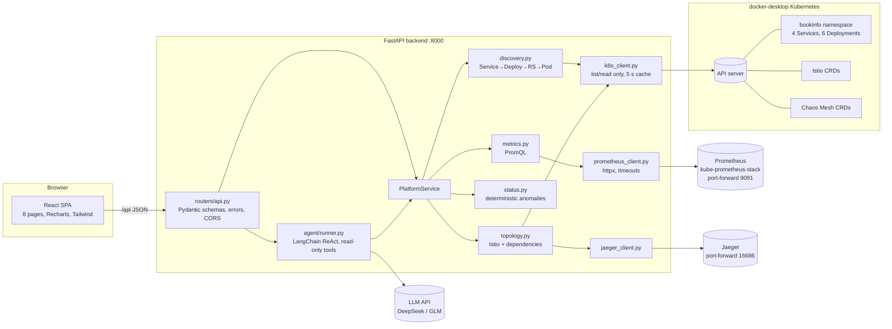
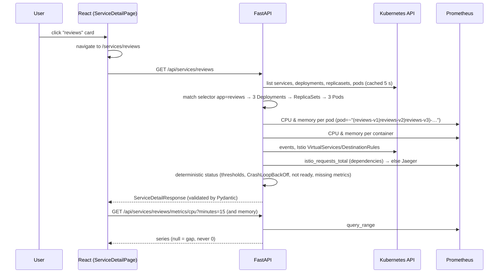
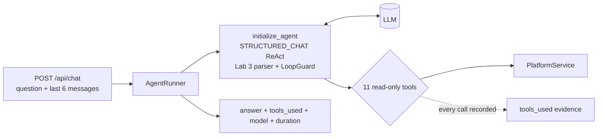

# Architecture

## 1. Component diagram

The REST API and the AI agent share **one** `PlatformService`. The dashboard and the agent therefore always see the same facts.

## 2. Data flow: opening a service detail page

## 3. Kubernetes integration

* **Configuration:** `kubernetes.config.load_kube_config(context=K8S_CONTEXT)`, or `load_incluster_config()` when
  `K8S_IN_CLUSTER=true`. If the context does not exist, the error lists the available contexts.
* **Read-only:** `k8s_client.py` only calls `list_*`, `get_code` and custom-object `list_*`. There is no create, patch,
  delete, scale or exec code anywhere, and a unit test checks this.
* **Linking (no hard-coded names):**
  * Service → Pods: `service.spec.selector ⊆ pod.metadata.labels`
  * Service → Deployments: `selector ⊆ deployment.spec.template.metadata.labels`
  * Pod → ReplicaSet → Deployment: `metadata.ownerReferences`
  * Version: label `version` (v1/v2/v3)

  As a result, `reviews` is one Service with three Deployments (reviews-v1/v2/v3), not three services.
* **Health (Kubernetes):** Healthy = all pods Running and Ready with no problems and every Deployment has ready = desired.
  Down = no ready pod. Degraded = anything in between. Unknown = the Service has no selector.
* **Istio:** VirtualServices, DestinationRules and Gateways are listed cluster-wide (the Bookinfo gateway VirtualService
  is in `default`), with a fallback to the namespace if that is forbidden.
* **Chaos Mesh:** objects in the namespace are listed so the overview can warn about a forgotten experiment.

## 4. Prometheus queries

| Purpose | PromQL (namespace `bookinfo`) | Unit |
|---|---|---|
| CPU per pod | `sum by (pod) (rate(container_cpu_usage_seconds_total{namespace="bookinfo",container!="",container!="POD"}[2m]))` | cores |
| CPU per container | same with `sum by (pod, container)` | cores |
| Memory per pod | `sum by (pod) (container_memory_working_set_bytes{namespace="bookinfo",container!="",container!="POD"}) / 1048576` | MiB |
| Restarts | `sum by (pod, container) (kube_pod_container_status_restarts_total{namespace="bookinfo"})` | count |
| Service filter | `pod=~"(reviews-v1\|reviews-v2\|reviews-v3)-[a-z0-9]+-[a-z0-9]+"` (built from discovered Deployments, so history of replaced pods is kept) | – |
| Dependencies | `sum by (source_workload, destination_workload, destination_service_name) (rate(istio_requests_total{reporter="destination",destination_workload_namespace="bookinfo"}[15m]))` | req/s |

Why the filters: `container!=""` removes the pod-level cgroup roll-up (otherwise usage would be counted twice), and
`container!="POD"` removes the pause container. The rate window (default `2m`) is at least four times the
kube-prometheus-stack scrape interval of 30 s.

Range queries use 5 min → 15 s step, 15 min → 30 s step and 60 min → 60 s step.

**Missing data rules:** an empty result stays empty; NaN/Inf become `null`; a pod missing from a result has `null`
values and `metrics_state = metrics_unavailable`; an unreachable Prometheus gives `prometheus_unavailable`.
Timestamps are UTC ISO 8601 (`…Z`).

## 5. Deterministic status

`status.evaluate()` checks every non-terminating pod:

1. Kubernetes problems (CrashLoopBackOff, ImagePullBackOff, Pending, Failed, not ready) → `anomalous`, severity critical
2. CPU > `CPU_THRESHOLD_CORES` (0.1) or memory > `MEMORY_THRESHOLD_MIB` (400) → `anomalous`, with pod, metric, value and threshold
3. Otherwise, Prometheus unreachable → `prometheus_unavailable`
4. Otherwise, a running pod without a CPU or memory sample → `metrics_unavailable`
5. Otherwise → `normal`

A missing metric can therefore never produce `normal`.

## 6. AI OpsAgent

Tools: `get_services`, `get_deployments`, `get_pods`, `get_pod_cpu_usage`, `get_pod_memory_usage`,
`get_container_restarts`, `get_pod_events`, `get_service_health`, `get_metric_trend`, `get_prometheus_status`,
`get_anomaly_status`.

Safety: the tools can only call read methods of `PlatformService`. The prompt states the read-only rule and the units.
LoopGuard blocks identical repeated calls, `max_iterations` defaults to 8, and LLM errors become HTTP 502/503 with the
API key removed from the message.

## 7. Frontend

React Router routes: `/`, `/services`, `/services/:name`, `/pods`, `/monitoring`, `/agent`, `/events`, `/settings`.
`useApi()` loads data, keeps old data while reloading, and reacts to the global refresh (button or 15 s auto refresh).
Every data view has a loading skeleton, an error state (with code and hint) and an empty state. In development Vite
proxies `/api` to `127.0.0.1:8000`; in Docker, nginx proxies `/api` to the `backend` container.
